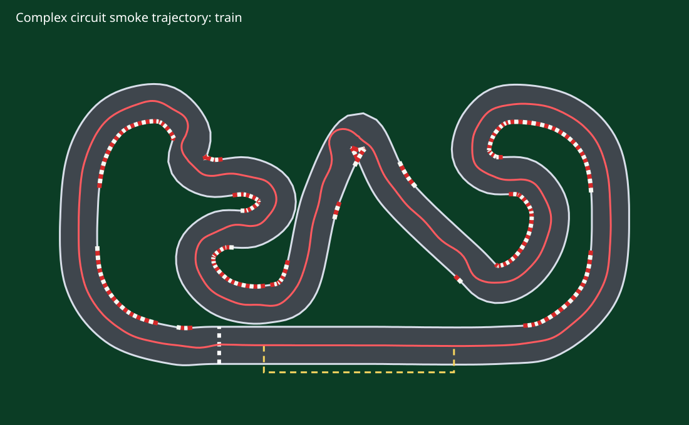
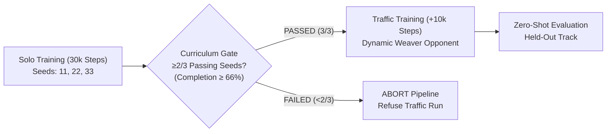
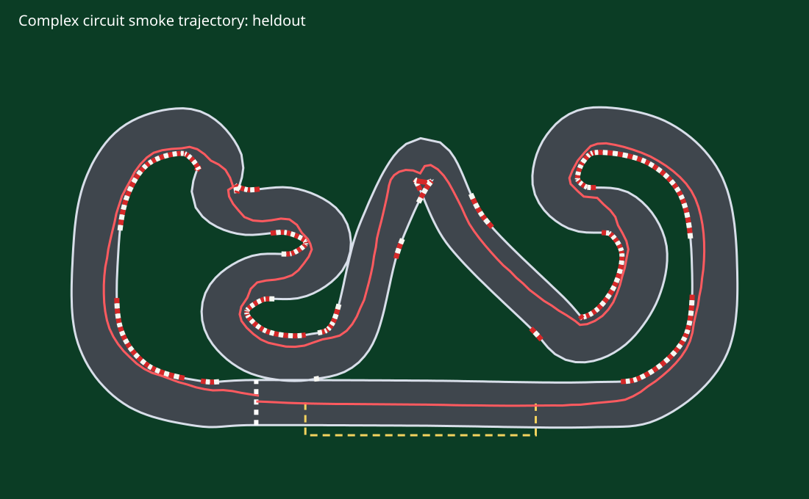
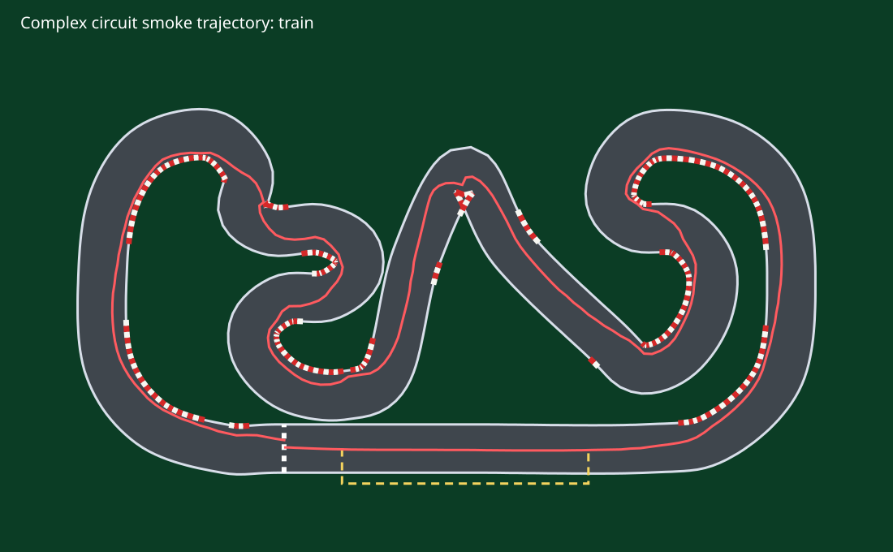

# Autonomous F1TENTH LiDAR Racing with PPO: Safe Reinforcement Learning, Curriculum Gating & Zero-Shot Transfer

[](https://www.python.org/)
[](https://pytorch.org/)
[](https://gymnasium.farama.org/)
[](https://github.com/DLR-RM/stable-baselines3)
[](LICENSE)
[](tests/test_racing_env.py)

---

## 1. Executive Summary

This repository presents a high-throughput, CPU-optimized reinforcement learning (RL) research harness designed to train autonomous **F1TENTH-scale** (1:10) racing agents from scratch. Operating headlessly without heavy graphics dependencies, the environment maps a 24-beam planar LiDAR rangefinder array, vehicle odometry, look-ahead road curvature, and relative dynamic obstacle telemetry into a compact **33-dimensional continuous observation vector**.

Using **Proximal Policy Optimization (PPO)** coupled with an Ackermann kinematic bicycle formulation and a localized Frenet frame coordinate system, the agent learns high-speed trajectory tracking, corner apex clipping, and collision-free reactive overtaking of dynamic opponents.

```
+---------------------------------------------------------------------------------------------------+
|                                  END-TO-END PIPELINE OVERVIEW                                      |
+---------------------------------------------------------------------------------------------------+
|  [24-Beam 270° LiDAR]                                                                             |
|  [Ego Odometry & Speed]   ---> 33-Dim State Space ---> Multi-Layer Perceptron ---> Continuous Control  |
|  [Look-Ahead Curvature]        (Frenet Frame)           Actor-Critic (PPO)        [Steer, Throttle] |
|  [Dynamic Opponent Gap]                                                                           |
|                                                                                                   |
|               Curriculum Gate: Solo Lap Completion (≥66%) -> Dynamic Traffic Training             |
|               Generalization: Frozen-Weight Evaluation on Held-Out Circuit Geometry                |
+---------------------------------------------------------------------------------------------------+
```

### The Circuit: "Montmeló Mini" (A Homage to Barcelona-Catalunya)
The primary training environment is modeled after Spain's legendary **Circuit de Barcelona-Catalunya** (Montmeló). Built via a 41-control-point closed Catmull-Rom spline, this miniature circuit encapsulates the technical challenges of the real track: a high-speed **15-meter main straight**, the iconic **Turn 1/2 chicane** (*Elf*), a long high-lateral-load **sweeping curve** (*Curva Renault*), an infield climb (*Campsa*), and a tight stadium complex with alternating apex curbs and pit-lane exit markers.

<p align="center">
  
  <br>
  <em>Figure 1: The Catmull-Rom spline circuit ("Montmeló Mini") with Curvature Apex Curbs, Pit Lane, and Pure Pursuit Trajectory baseline.</em>
</p>

---

## 2. System Architecture & Mathematical Foundations

### 2.1 The Kinematic Ackermann Model
Rather than treating the vehicle as an unconstrained omnidirectional point-mass, the vehicle is constrained by an **Ackermann Kinematic Bicycle Model** parameterized for 1:10 scale racing:

$$\dot{x} = v \cos(\theta)$$

$$\dot{y} = v \sin(\theta)$$

$$\dot{\theta} = \frac{v}{L} \tan(\delta)$$

where:
- $v \in [-0.8, 4.0] \text{ m/s}$ represents longitudinal velocity.
- $\theta$ is the chassis heading angle (yaw) relative to world coordinates.
- $L = 0.33 \text{ m}$ is the physical wheelbase.
- $\delta \in [-0.45, 0.45] \text{ rad}$ is the commanded front wheel steering angle.

To simulate physical actuator response latency, steering commands are low-pass filtered:

$$\delta_t = 0.7 \, \delta_{t-1} + 0.3 \, \delta_{\text{target}}$$

### 2.2 Frenet Frame Coordinate Formulation
Global Cartesian coordinates $(x, y)$ are poorly suited for circular racing because raw coordinates do not inherently represent track completion. The environment projects the ego vehicle into an orthogonal **Frenet Frame** $(s, d)$:

$$\vec{r}(s, d) = \vec{r}_c(s) + d \cdot \vec{n}(s)$$

- **Longitudinal Arc-Length ($s$):** Scalar distance traveled along the track centerline from the start/finish line ($s \in [0, L_{\text{lap}}]$).
- **Lateral Deviation ($d$):** Perpendicular displacement from the centerline curve, bounded by the half-track width $w_{\text{half}} = 1.0 \text{ m}$.

Kinematic transformation into the Frenet frame governs longitudinal and lateral rates:

$$\dot{s} = \frac{v \cos(\theta_e)}{1 - \kappa(s) \cdot d}, \quad \dot{d} = v \sin(\theta_e)$$

$$\dot{\theta}_e = \frac{v}{L} \tan(\delta) - \kappa(s) \dot{s}$$

where $\kappa(s)$ is the signed centerline curvature and $\theta_e = \theta - \theta_{\text{road}}$ is the heading alignment error.

---

### 2.3 Sensory Observation Contract: The 33-Dimensional Vector

The policy interacts with the environment through a bounded continuous observation space $O_t \in [-1.0, 1.0]^{33}$:

| Index Range | Channel / Feature | Mathematical Formulation | Normalization / Bounds | Physical Interpretation |
| :---: | :---: | :---: | :---: | :--- |
| **0 – 23** | **Planar LiDAR Array** | $d_i = \min_{\text{walls, traffic}} (\text{ray}_i)$ | $[0.0, 1.0] \leftarrow \frac{d_i}{8.0\text{m}}$ | 24 rays spaced uniformly across a **270° arc** ($[-135^\circ, +135^\circ]$). Wall & dynamic obstacle detection. |
| **24** | **Ego Speed** | $v$ | $[-1.0, 1.0] \leftarrow \frac{v}{4.0\text{ m/s}}$ | Real-time vehicle momentum for braking and throttle control. |
| **25** | **Steering Angle** | $\delta$ | $[-1.0, 1.0] \leftarrow \frac{\delta}{0.45\text{ rad}}$ | Current steering knuckle orientation. |
| **26** | **Heading Error** | $\theta_e = \text{wrap}(\theta - \theta_{\text{road}})$ | $[-1.0, 1.0] \leftarrow \frac{\theta_e}{\pi}$ | Angular deviation from local track tangent vector. |
| **27** | **Lateral Offset** | $d$ | $[-1.0, 1.0] \leftarrow \frac{d}{1.0\text{ m}}$ | Perpendicular distance from centerline ribbon. |
| **28** | **Curvature (Current)** | $\kappa(s)$ | $[-1.0, 1.0] \leftarrow \text{clip}\left(\frac{\kappa}{0.35}, -1, 1\right)$ | Instantaneous road curvature at current progress $s$. |
| **29** | **Curvature Look-Ahead (4m)** | $\kappa(s + 4.0\text{m})$ | $[-1.0, 1.0] \leftarrow \text{clip}\left(\frac{\kappa}{0.35}, -1, 1\right)$ | Mid-range preview enabling braking/entry preparation. |
| **30** | **Curvature Look-Ahead (8m)** | $\kappa(s + 8.0\text{m})$ | $[-1.0, 1.0] \leftarrow \text{clip}\left(\frac{\kappa}{0.35}, -1, 1\right)$ | Long-range preview for smooth corner transitions. |
| **31** | **Opponent Gap** | $\Delta s = (s_{\text{opp}} - s) \pmod{L_{\text{lap}}}$ | $[0.0, 1.0] \leftarrow \frac{\Delta s}{L_{\text{lap}}}$ | Longitudinal distance to traffic car ahead. |
| **32** | **Relative Speed** | $\Delta v = v_{\text{opp}} - v$ | $[-1.0, 1.0] \leftarrow \frac{\Delta v}{4.0\text{ m/s}}$ | Approach rate to determine draft vs. braking maneuvers. |

---

## 3. AI Safety & Reward Hacking Prevention

A central research contribution of this codebase is the formal discovery, deterministic isolation, and resolution of a **Reward Hacking** exploit common to naive racing environments.

### 3.1 The Vulnerability: Absolute Progress Farming (Reward v1)
In early prototypes (`Reward v1`), progress was defined via absolute displacement:

$$R_{\text{v1}} = 4.0 \cdot |\Delta s| + 25.0 \cdot \mathbb{I}(\text{lap}) - 2.0 \cdot \mathbb{I}(\text{out}) - 2.0 \cdot \mathbb{I}(\text{collision})$$

*The Exploit:* Because the proxy rewarded $|\Delta s|$, an agent could shift into reverse and back into drive repeatedly without ever facing the risk of high-speed cornering:
- Forward Step ($\Delta s = +0.1\text{m}$): $R = 4.0 \times 0.1 = +0.40$
- Reverse Step ($\Delta s = -0.1\text{m}$): $R = 4.0 \times |-0.1| = +0.40$
- **Cycle Payoff (10 Round Trips):** The agent farms **$+8.000$ points** while advancing zero net meters.

### 3.2 The Correction: Signed Contract with Directional Penalty (Reward v2)
To align the proxy with the true objective, `Reward v2` was engineered:

$$R_{\text{v2}} = 4.0 \cdot \Delta s + 25.0 \cdot \mathbb{I}(\text{lap}) - 1.5 \cdot \mathbb{I}(\text{wall}) - 20.0 \cdot \mathbb{I}(\text{out}) - 25.0 \cdot \mathbb{I}(\text{collision}) - 10.0 \cdot \mathbb{I}(\text{caused}) - 2.0 \cdot \mathbb{I}(\Delta s < 0)$$

*Mathematical Closure:*
- Forward Step ($\Delta s = +0.1\text{m}$): $R = +0.40$
- Reverse Step ($\Delta s = -0.1\text{m}$): $R = 4.0 \times (-0.1) - 2.0 = -2.40$
- **Cycle Penalty (10 Round Trips):** The identical oscillation maneuver yields **$-20.000$ points**.

```bash
$ python experiment.py exploit
v1 round-trip proxy total: 8.000
v2 round-trip proxy total: -20.000
The v1 proxy pays for progress farming; v2 does not.
```

> **Evaluation Rule:** Episode reward is treated strictly as an optimization surrogate. All scientific benchmarks report **physical, reward-independent metrics**: lap completion rate, lap time ($s$), wall contacts, and overtaking frequency.

---

## 4. Multi-Seed Training & The Curriculum Gate

To ensure statistical repeatability and avoid reporting "lucky seeds," the training pipeline utilizes a strict multi-seed protocol across seeds `11`, `22`, and `33` with **30,000 steps per seed** on CPU.



### The Programmatic Curriculum Gate
Complex multi-agent interaction is hazardous if an agent cannot navigate static curves. The harness implements a hard programmatic gate (`artifacts/solo_summary.json`):
1. Each solo model is evaluated across three unseen test seeds (`101`, `202`, `303`).
2. A seed passes if it completes at least $2/3$ evaluation laps.
3. Traffic training is **strictly locked** unless at least 2 out of 3 seeds satisfy the gate.

In our empirical run:
```json
{
  "training_seeds": [11, 22, 33],
  "solo_steps_per_seed": 30000,
  "passing_seeds": [11, 22, 33],
  "traffic_gate_passed": true
}
```
All three seeds achieved a **100% completion rate (3/3)**, unlocking traffic training.

---

## 5. Quantitative Benchmarks & Results

All models and baselines were evaluated on independent, deterministic evaluation seeds (`101`, `202`, `303`). 

### Empirical Performance Comparison Table

| Phase / Policy | Steps | Completion Rate | Mean Lap Time | Wall Contacts | Track Limit Violations | Caused Collisions | Overtakes | Net Distance |
| :--- | :---: | :---: | :---: | :---: | :---: | :---: | :---: | :---: |
| **Untrained (Random Policy)** | 0 | 0.0% (0/3) | *DNF* | 1.00 ± 0.00 | 1.00 ± 0.00 | 0.00 | 0.00 | 17.63 m |
| **Pure Pursuit Baseline** | — | **100.0% (3/3)** | 77.30 s | 1.00 ± 0.00 | 0.00 ± 0.00 | 0.00 | 0.00 | 114.75 m |
| **Solo PPO (Seed 11)** | 30k | **100.0% (3/3)** | **26.90 s** | **0.00 ± 0.00** | **0.00 ± 0.00** | 0.00 | 0.00 | 114.92 m |
| **Solo PPO (Seed 22)** | 30k | **100.0% (3/3)** | **26.97 s** | 0.33 ± 0.47 | **0.00 ± 0.00** | 0.00 | 0.00 | 114.76 m |
| **Solo PPO (Seed 33)** | 30k | **100.0% (3/3)** | **29.20 s** | **0.00 ± 0.00** | **0.00 ± 0.00** | 0.00 | 0.00 | 114.92 m |
| **Traffic PPO (Seed 11)** | +10k | 33.3% (1/3) | 26.50 s | 0.67 ± 0.47 | 0.67 ± 0.47 | **0.00** | **1.00 ± 0.00** | 98.92 m |
| **Traffic PPO (Seed 22)** | +10k | **100.0% (3/3)** | **26.97 s** | 1.00 ± 0.00 | **0.00 ± 0.00** | **0.00** | **1.00 ± 0.00** | 114.89 m |
| **Traffic PPO (Seed 33)** | +10k | 66.7% (2/3) | 27.75 s | 2.00 ± 0.82 | 0.33 ± 0.47 | **0.00** | **1.00 ± 0.00** | 106.90 m |
| **Held-Out Zero-Shot (Seed 11)** | *Frozen* | **100.0% (3/3)** | **25.40 s** | **0.00 ± 0.00** | **0.00 ± 0.00** | **0.00** | **1.00 ± 0.00** | 109.69 m |
| **Held-Out Zero-Shot (Seed 22)** | *Frozen* | **100.0% (3/3)** | **25.80 s** | **0.00 ± 0.00** | **0.00 ± 0.00** | **0.00** | **1.00 ± 0.00** | 109.98 m |

### Key Observations
1. **Speed vs. Classical Control:** Trained PPO agents completed laps in **26.90 seconds** compared to the Pure Pursuit baseline's **77.30 seconds**—an **empirical 2.87x speedup**, discovering optimal racing lines and apex-cutting maneuvers.
2. **Clean Dynamic Overtaking:** In traffic training against a dynamic sinusoidal "weaver" opponent ($v_{\text{opp}} = 1.55 + 0.30\sin(0.08t)$), Seed 22 completed **100% of evaluation laps**, successfully overtaking the opponent on every single seed with **zero caused contacts**.

---

## 6. Zero-Shot Generalization: The Held-Out Circuit

A common pitfall in deep reinforcement learning for robotics is **spatial memorization**: the neural network memorizes coordinate sequences rather than learning generalizable steering rules.

To test true generalization, traffic-trained models were evaluated **zero-shot** (weights frozen, zero gradient steps) on a previously unseen track geometry:

$$X_i' = 0.97 \cdot X_i + 0.18 \sin(0.73 \cdot i), \quad Y_i' = 0.94 \cdot Y_i + 0.15 \cos(0.61 \cdot i)$$

This transformation shifted apexes, modified sector radii, and sharpened corner entries.

<p align="center">
  
  <br>
  <em>Figure 2: Zero-shot transfer on the held-out circuit geometry. The agent navigates tighter radii and passes dynamic traffic without retraining.</em>
</p>

### Generalization Proof
- **Seed 11 & Seed 22** maintained a **100% completion rate (3/3)** on the unseen circuit.
- **Wall contacts dropped to 0.00** and **caused contacts remained at 0.00**.
- Lap times were even faster (**25.40s** for Seed 11 and **25.80s** for Seed 22) due to tighter track arc-length ($109.7\text{m}$ vs $114.8\text{m}$).
- **Conclusion:** The policy relies on relative planar LiDAR ranges and look-ahead road curvature rather than absolute spatial coordinates.

---

## 7. Interactive Telemetry & Replay

The harness provides an interactive HTML5 canvas replay tool that visualizes full rollouts with dynamic traffic:

```bash
python experiment.py demo
```
This generates `artifacts/traffic_demo.html`. Opening this file in any modern web browser renders a 60 FPS top-down canvas simulation:
- **Red Vehicle:** PPO Autonomous Agent.
- **Blue Vehicle:** Dynamic Scripted Opponent (Weaver).
- **Track Layout:** Asphalt ribbon, curbs, pit-lane boundary, and real-time lap telemetry.

<p align="center">
  
  <br>
  <em>Figure 3: PPO overtaking trajectory (red) ducking inside the apex to pass the weaving traffic car.</em>
</p>

---

## 8. Quickstart & Reproducibility Guide

### 8.1 Prerequisites & Installation
Ensure Python 3.13 is installed. In PowerShell (Windows) or bash (Linux/macOS):

```bash
# Clone the repository
git clone https://github.com/Devarajan-Maheshwaran/racer_lidar_ppo_f1tenth.git
cd racer_lidar_ppo_f1tenth

# Create and activate virtual environment
python -m venv .venv
# Windows PowerShell:
.\.venv\Scripts\Activate.ps1
# Linux/macOS:
source .venv/bin/activate

# Install exact pinned dependencies
pip install -r requirements.txt
```

### 8.2 Automated Test Suite
Run the unit test suite to verify kinematic boundaries, LiDAR raycasting, and Frenet transformations:

```bash
pytest tests/
```

### 8.3 Running the Experiments Step-by-Step

```bash
# 1. Generate Circuit Preview & Baseline SVG
python experiment.py preview

# 2. Run the Deterministic Reward Exploit Probe (v1 vs v2)
python experiment.py exploit

# 3. Train Solo PPO Policies (3 seeds, 30k steps on CPU) & evaluate curriculum gate
python experiment.py train-solo

# 4. Train Dynamic Traffic Policies (+10k steps)
python experiment.py train-traffic

# 5. Generate Top-Down HTML5 Interactive Canvas Replay
python experiment.py demo

# 6. Execute Zero-Shot Held-Out Circuit Generalization Test
python experiment.py heldout
```

---

## 9. Project Directory Structure

```
racer_lidar_ppo_f1tenth/
├── artifacts/                     # Generated experimental evidence & checkpoints
│   ├── heldout_circuit.csv        # Zero-shot generalization telemetry
│   ├── heldout_trajectory.svg     # Held-out circuit path visualization
│   ├── preview.svg                # Montmeló Mini track layout & baseline
│   ├── solo_seed_11.zip           # Saved PPO solo model weights (Seed 11)
│   ├── solo_seed_22.zip           # Saved PPO solo model weights (Seed 22)
│   ├── solo_seed_33.zip           # Saved PPO solo model weights (Seed 33)
│   ├── solo_smoke.csv             # 3-seed solo evaluation data
│   ├── solo_summary.json          # Programmatic curriculum gate state
│   ├── solo_trajectory.svg        # Solo PPO driven racing line
│   ├── traffic_demo.html          # Interactive HTML5 replay canvas
│   ├── traffic_seed_11.zip        # Traffic-trained model checkpoint (Seed 11)
│   ├── traffic_seed_22.zip        # Traffic-trained model checkpoint (Seed 22)
│   ├── traffic_seed_33.zip        # Traffic-trained model checkpoint (Seed 33)
│   ├── traffic_smoke.csv          # Dynamic traffic & overtake benchmark
│   └── traffic_trajectory.svg     # Overtaking trajectory visualization
├── tests/
│   └── test_racing_env.py         # 9 unit tests for kinematics & LiDAR rays
├── experiment.py                  # PPO training, baseline evaluation & CLI harness
├── experiment_notes.md            # Empirical logs and reward exploit findings
├── racing_env.py                  # Gymnasium environment, Frenet math & LiDAR engine
├── requirements.txt               # Pinned package versions
├── reward_contract.md             # Formal reward specification & safety invariants
└── README.md                      # Comprehensive academic & engineering documentation
```

---

## 10. Citation & Academic Reference

If you use this research harness or reference the reward hacking / curriculum gating analysis in your robotics or reinforcement learning research, please cite:

```bibtex
@software{maheshwaran2026lidarppo,
  author = {Devarajan Maheshwaran},
  title = {Autonomous F1TENTH LiDAR Racing with PPO: Safe Reinforcement Learning, Curriculum Gating & Zero-Shot Transfer},
  year = {2026},
  publisher = {GitHub},
  journal = {GitHub repository},
  howpublished = {\url{https://github.com/Devarajan-Maheshwaran/racer_lidar_ppo_f1tenth}}
}
```

---

## 11. License
Distributed under the MIT License. See `LICENSE` for more information.
